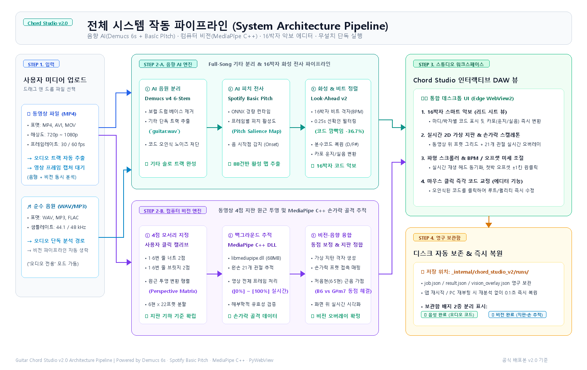

<div align="center">


# Guitar Chord Studio v2.0 🎸

**AI 기반 6-Stem 기타 음원 분리 · 16박자 악보 전사 · MediaPipe C++ 손가락 비전 추적 · 무설치 단독 실행 데스크톱 솔루션**

[](https://github.com/evev2345-cpu/guitar-chord-studio)
[-0D9488?style=flat-square)](https://github.com/evev2345-cpu/guitar-chord-studio)
[](https://github.com/evev2345-cpu/guitar-chord-studio)
[](https://github.com/evev2345-cpu/guitar-chord-studio)
[-0078D7?style=flat-square&logo=microsoftedge&logoColor=white)](https://github.com/evev2345-cpu/guitar-chord-studio)
[](LICENSE)

<br/>

음원(MP3, WAV) 또는 연주 영상(MP4, AVI, MOV)을 업로드하면, AI 딥러닝 모델(`htdemucs_6s`, `Basic Pitch`)이 기타 음원을 고품질로 분리하여 16박자 단위 정밀 코드 악보를 생성하고, 화면 위 연주자의 손가락과 기타 지판을 3차원으로 실시간 추적해 주는 전문 기타 연습 및 채보 프로그램입니다.

</div>

---

## 🗺️ 전체 시스템 작동 파이프라인 (System Pipeline)

<div align="center">
  
</div>

### 4단계 핵심 처리 흐름

1. **STEP 1. 미디어 입력 (Input)**:
   * **동영상(MP4, AVI, MOV)**: 오디오 트랙 자동 분리 추출 및 영상 프레임 캡처 대기 (음향 + 비전 융합 모드).
   * **순수 음원(WAV, MP3, FLAC)**: 오디오 단독 분석 경로로 직행 (비전 연산 생략, 경량 고속 모드).
2. **STEP 2. 듀얼 AI 백그라운드 분석 (Dual AI Engine)**:
   * **음향 AI (Track A)**: `Demucs v4 6-Stem` 모델로 보컬·드럼·베이스를 제거하고 기타 단독 트랙(`guitar.wav`) 추출 → `Spotify Basic Pitch ONNX` 88건반 피치 활성도(Pitch Salience) 및 온셋 감지 → `Look-Ahead v2` 화성 엔진이 16박자 비트 격자(BPM) 정렬 및 0.25초 선확인(코드 깜빡임 -36.7%, `D/F#` 분수코드 복원).
   * **컴퓨터 비전 AI (Track B, 동영상 전용)**: 사용자 4점 모서리(1·6번 줄 너트/브릿지) 지정으로 원근 투영 변환(Homography) 행렬 도출 → `Google MediaPipe Hand Landmarker` C++ 바이너리(`libmediapipe.dll`, 68MB)로 왼손 21개 관절 백그라운드 프레임별 추적 → 가상 지판 격자 정합 및 저음현 근음 우선 가점(B6 vs G#m7 동점 해결).
3. **STEP 3. 인터랙티브 스튜디오 워크스페이스 (DAW Workspace)**:
   * `Microsoft Edge WebView2` 엔진 기반 통합 데스크톱 창에서 16박자 스마트 악보(리드 시트 뷰), 동영상 위 실시간 가상 지판 & 손가락 스켈레톤 오버레이, 파형 스크롤러 및 재생 헤드 실시간 동기화.
   * 악보 상의 특정 코드 블록을 클릭하여 즉각 교정(루트/퀄리티 변경) 가능.
4. **STEP 4. 영구 보관함 (Persistence Storage)**:
   * 모든 분석 결과, 분리 음원, 수정 내역, 비전 오버레이는 `_internal/chord_studio_v2/runs/<job_id>/`에 영구 보존.
   * 프로그램을 껐다 켜거나 PC를 재부팅해도 **0.1초 만에 재분석 없이 즉시 복원**.
   * 보관함 목록에 **`[✓ 음성 완료]`**와 **`[✓ 비전 완료]`** 배지 분리 제공.

---

## ✨ 핵심 기능 (Key Features)

| 기능 항목 | 기술 스펙 및 설명 |
| :--- | :--- |
| **완전 무설치 독립 실행** | **Python, FFMpeg, Visual C++ 재배포 패키지 설치 0%**. 순정 Windows PC에서 `GuitarChordStudio.exe` 더블 클릭만으로 즉시 구동 (단독 배포 ZIP 용량: **405 MB**). |
| **무소음 백그라운드 프로세싱** | Windows 서브프로세스 파라미터(`CREATE_NO_WINDOW`, `SW_HIDE`) 전역 적용으로 `ffprobe`, `ffmpeg`, AI 워커 실행 시 콘솔 검은 창 깜빡임 0%. |
| **AI 6-Stem 기타 음원 분리** | Meta `Demucs v4 (htdemucs_6s)` 딥러닝 분리 엔진 내장. 복잡한 밴드 믹스에서 기타 솔로 트랙만 격리하여 코드 판별 오차 극소화. |
| **16박자 비트 격자 & Look-Ahead v2** | 자동 BPM 템포 및 첫박 오프셋 동기화. 0.25초 오프라인 선확인을 적용하여 초단기 코드 깜빡임을 36.7% 제거하고 물리적 저음 전위 분수코드(`D/F#` 등) 정밀 복원. |
| **MediaPipe C++ 손가락 비전 추적** | Google `MediaPipe Hand Landmarker` C++ 네이티브 동적 라이브러리(`libmediapipe.dll`) 탑재. 프레임별 손가락 21개 관절 스켈레톤 실시간 백그라운드 추적 및 해부학적 유효성 검증. |
| **실시간 지판 비전 인디케이터** | 상단 툴바에 백그라운드 비전 처리율(`⏳ 지판 비전 분석 중 (0%~100%)` → `✓ 지판 비전 활성`) 실시간 펄스 인디케이터 제공. |
| **마우스 클릭 코드 즉각 교정** | 분석된 악보의 마디별 코드를 마우스로 클릭하여 원하는 코드(루트 및 Major, minor, 7, m7 등)로 즉시 변경 가능하며, 수정 즉시 영구 저장. |
| **영구 보관함 (0.1초 즉시 복원)** | 디스크 기반 상태 동기화 구조로 프로그램 재시작 시 기존 분석했던 모든 곡과 비전 데이터를 0.1초 만에 그대로 로드. |

---

## 📁 프로젝트 구조 (Clean Architecture)

```text
GUITAR/
├── 🎸 desktop_chord_studio.py # 네이티브 데스크톱 실행 진입점 (PyWebView + Edge WebView2)
├── 📦 GuitarChordStudio.spec  # PyInstaller 405MB 무설치 패키징 명세서
├── 🖼️ chord_studio_pipeline_white.png # 시스템 전체 작동 파이프라인 인포그래픽
├── 🎨 app_icon.png            # 1024x1024 초고해상도 벡터 투명 아이콘 에셋
├── 🎨 app_icon.ico            # Windows 실행 파일 바이너리 아이콘
├── chord_studio_v2/           # 모던 Chord Studio v2 애플리케이션
│   ├── server_v2.py           # 고속 비동기 API 서버 (포트 8766)
│   ├── static/                # 모던 스튜디오 UI (index.html, app.js, style.css)
│   └── runs/                  # 영구 분석 보관함 디렉토리 (곡별 job, result, media 보존)
├── engine/                    # 핵심 분석 & 인퍼런스 엔진 (19개 모듈)
│   ├── harmony_engine.py      # 크로마 풀링, 코드 템플릿 매칭 & 스코어링
│   ├── harmonic_context.py    # 조성 추정 및 전체 음원 앵커링 보정
│   ├── chord_presentation.py  # Look-Ahead v2 코드 표시 안정화 & 분수코드 복원
│   ├── beat_grid.py           # 16박자 템포 추정 및 비트 격자 정렬
│   ├── onset_transition.py    # 온셋 전환 감지
│   ├── run_local_separation.py# Demucs 6-stem 음원 분리 워커
│   ├── basic_pitch_worker.py  # Spotify Basic Pitch ONNX 전사 워커
│   ├── virtual_string_grid.py # 가상 6현 & 22프렛 지오메트리 그리드 생성
│   ├── hand_fret_tracker.py   # 지판 위 손가락 프렛 추적기
│   ├── improve_hand_skeleton.py # MediaPipe 관절 지터 완화 및 스켈레톤 보정
│   └── low_string_root_prior.py # 저음현(6·5번현) 운지 근음 우선 가점
├── models/                    # AI 모델 가중치 바이너리
│   ├── nmp.onnx               # 음향 코드 판단 경량 ONNX 모델
│   └── hand_landmarker.task   # MediaPipe 손가락 21개 관절 랜드마크 모델
├── dataset/                   # 검증 및 튜토리얼 벤치마크 데이터
├── tests/                     # 326개 전체 유닛 테스트 및 계약 테스트 모음
├── requirements-deploy.txt    # 배포 및 개발용 의존성 패키지 목록
└── LICENSE                    # MIT 라이선스
```

---

## 🚀 빠른 시작 (Quick Start)

### 1. 배포용 무설치 데스크톱 앱 (일반 사용자)
1. 릴리즈 압축 파일 `GuitarChordStudio_v2.0_Windows.zip` (약 405 MB) 압축 해제
2. 폴더 내 `GuitarChordStudio.exe` 더블 클릭하여 즉시 실행 (Python 설치 불필요)
3. 함께 동봉된 `ChordStudio_v2.0_사용자_매뉴얼.docx`를 통해 조작법 확인

### 2. 개발자 로컬 개발 모드
```powershell
# 1. 의존성 패키지 설치
pip install -r requirements-deploy.txt

# 2. 데스크톱 앱 실행
python desktop_chord_studio.py

# 또는 웹 브라우저 모드로 단독 실행
python chord_studio_v2/server_v2.py --port 8766 --open
```

### 3. 유닛 및 통합 테스트 실행
```powershell
# 파이썬 유닛 테스트 (326개 전체 테스트 통과)
python -m unittest discover tests

# 프론트엔드 계약 검증 테스트
node tests/test_chord_web_ui.js
```

---

## 📄 라이선스 (License)

This project is licensed under the MIT License - see the [LICENSE](LICENSE) file for details.
