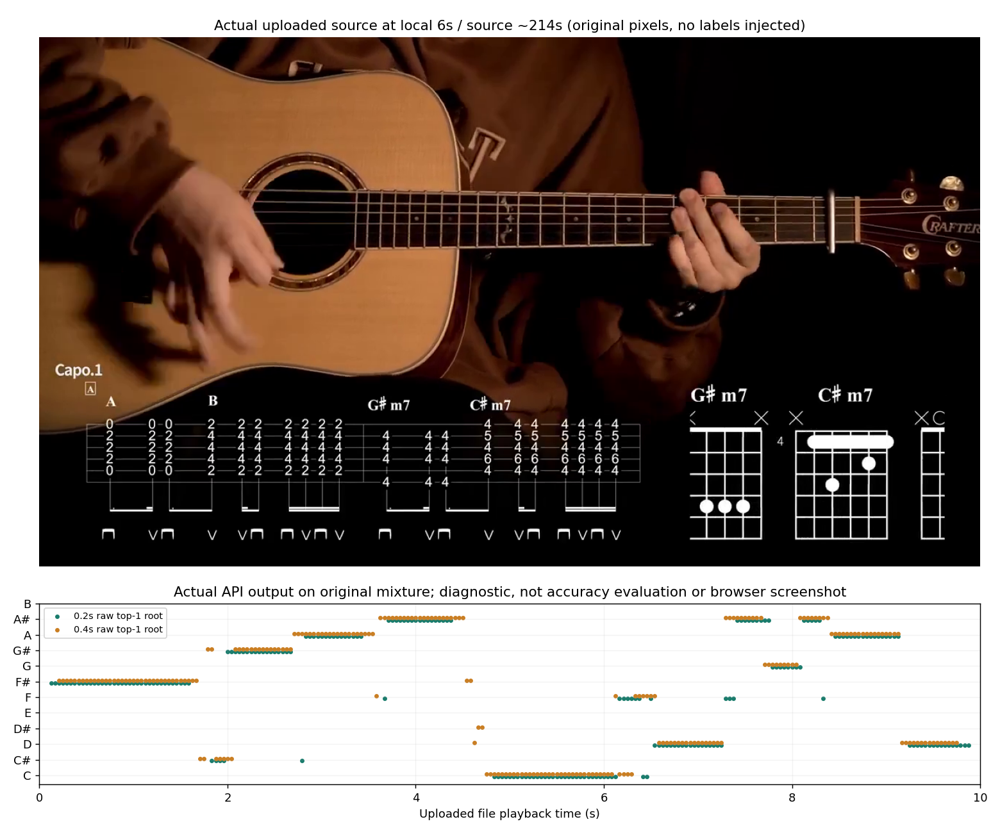

# 코드 분석기 웹앱 1차 구현 — 2026-11-05

기존 Python 오디오 분석기를 브라우저에서 사용할 수 있는 **Chord Studio**를 만들었다. 로컬 서버는 `http://127.0.0.1:8765`에서 실행 중이다. 타브 제작은 다음 마일스톤으로 유지한다.

## 제공하는 흐름

파일 선택 또는 드롭 → 순차 분석 대기열 → 재생용 미디어 준비 → 기존 Basic Pitch ONNX 추론 → 0.2/0.4초 코드 후보 → 재생 시간에 맞춘 표시 순서다. 실음/카포 운지 전환, 카포 0~12, 동점 복수 후보, 클릭 가능한 타임라인, 다음 표시 후보, 최근 결과 복원, JSON 내보내기를 추가했다.

첫 버전의 입력은 최대 150MB, 0.5초~5분 파일이다. 영상은 브라우저용 H.264/AAC로 변환하고 음원은 WAV로 제공한다. 브라우저 재생 속도와 탐색 시 플레이어의 재생 시간을 읽어 표시하도록 구현했다. 실제 브라우저 상호작용은 아래 제한 때문에 아직 검수하지 못했다.

## 기존 엔진과의 연결

`chord_web_analysis.py`는 기존 `render_audio_video_review.predictions`, `temporal_audio_pool`, 코드 채점기와 `chord_display_cleanup.stabilize`를 재사용한다. 24Hz 시간축으로 기존 정리 규칙의 프레임 단위를 유지한다. 기존 worker에 `--modes raw` 선택지만 추가했고, 종전 기본값 raw/cut 두 경로는 유지했다. 웹 분석에서 추가 파형 주파수 컷이나 새 모델 학습은 하지 않는다.

모델은 설치된 `.venv-audio-model`을 별도 프로세스로 호출한다. 새 의존성을 설치하지 않았다. 단일 작업자·최대 4건 대기열로 동시에 여러 모델이 메모리를 점유하지 않도록 했다. 업로드·상태·결과·미디어를 분리해 후속 확장 프로그램에서도 API를 재사용할 수 있다.

손·지판 비전은 웹 분석에 아직 연결하지 않았다. 화면에도 ‘오디오 분석 · 비전 미연결’로 표시한다. 기타 분리 자동화도 포함하지 않으므로 원음에 있는 다른 악기가 음 후보에 반영될 수 있다. 샘플 버튼은 기존 기타 분리음과 저장된 분석 결과를 사용하며 새 추론으로 표시하지 않는다.

## 실제 파일 검증

원본 튜토리얼 208~218초를 10초 MP4로 준비해 **실제 업로드 API에 전송하고 새 추론**을 실행했다. 작업 `c2be0a0b8ca84370943fb3d8f327bf02`가 완료됐고, 각 시간창에서 240개 결과 행을 반환했다. 0.2초 원시 후보가 있는 행은 209개이며 이는 정답 수가 아니다. 모델 로그의 추론 소요 시간은 1.5초다. 아래는 실제 업로드 영상 6초 프레임과 API의 원시 1순위 근음 출력이다. 동점·코드 품질은 이 그림에 전부 표현하지 않으므로 정확도 평가로 해석하지 않는다.



[실제 처리된 영상](../webapp/runs/c2be0a0b8ca84370943fb3d8f327bf02/media.mp4) · [실제 결과 JSON](../webapp/runs/c2be0a0b8ca84370943fb3d8f327bf02/result.json) · [검증 기록](../webapp/validation.json)

기존 기타 분리음 샘플에서는 원본 214초(샘플 재생 20초)의 C6/Am7 동점을 보존했다. 카포 1 표기에서 B6/G#m7로 환산하는 프런트엔드 계약도 검사했다. 특정 정답에 맞춰 후보를 교체하지 않았다.

## 검증 결과와 제한

- 기존 회귀와 웹 테스트 **184개 통과**. 무음·가장자리 보류, 214초 동점 보존, 업로드 검증, 다른 Origin 차단, 임의 경로 접근 차단, 샘플 완료와 JSON, HTTP 206 바이트 범위 탐색을 검사했다.
- Node에서 프런트엔드 계약 **5개 통과**. 카포 환산·동점 유지·보류를 확인했다. 이 검사는 DOM 렌더링이나 브라우저 재생 검사가 아니다.
- 새 MP4의 전체 영상·오디오 디코딩이 오류 없이 끝났고, 미디어 API의 부분 요청도 206/64바이트로 확인했다.
- **브라우저 자동 검수는 미완료.** Browser Use의 origin 승인 단계가 로컬 URL 접근을 거절했다. 다른 브라우저나 우회 경로를 시도하지 않았다. 이 보고서의 사진은 실제 원본과 API 결과이며 웹앱 화면 캡처가 아니다.

```powershell
python chord_web_server.py --open
python -m unittest test_chord_web -q
node test_chord_web_ui.js
```

서버는 로컬 주소에만 바인딩한다. 공개 서비스 배포는 이번 범위가 아니다. 입력과 결과는 `webapp/runs`에 보관하며 기존 연구 결과를 덮어쓰지 않는다. 자세한 실행법과 API는 [웹앱 사용법](../webapp/README.md)에 있다.

다음 작업은 사용자가 실제 브라우저에서 재생·탐색·속도 변경과 모바일 폭을 확인한 뒤 UI 문제를 수정하는 것이다. 이어서 기타 분리 선택과 검증된 비전 근음 가점을 연결하고, 같은 결과 API를 사용하는 유튜브 오버레이 확장으로 발전시킨다.
