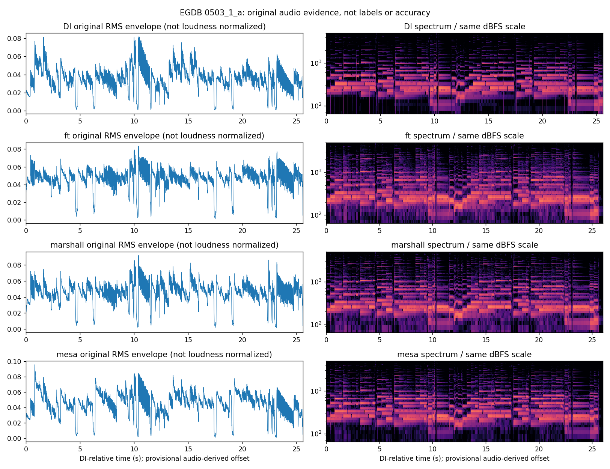
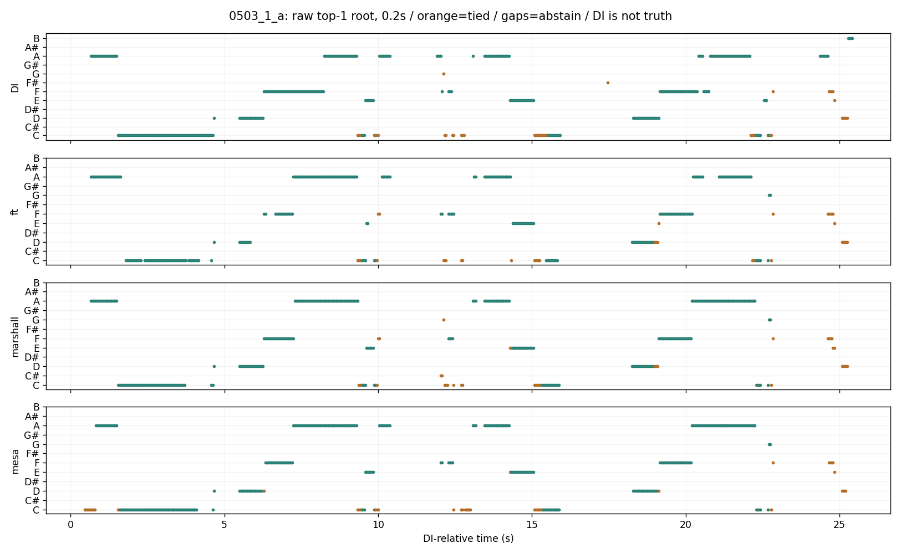
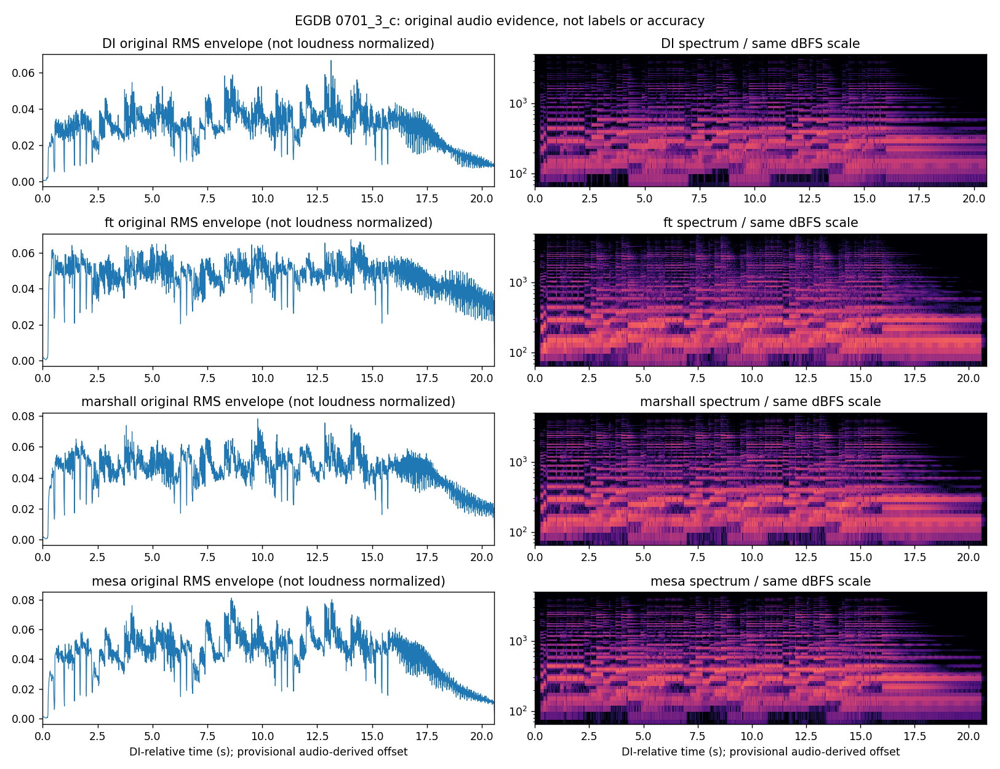
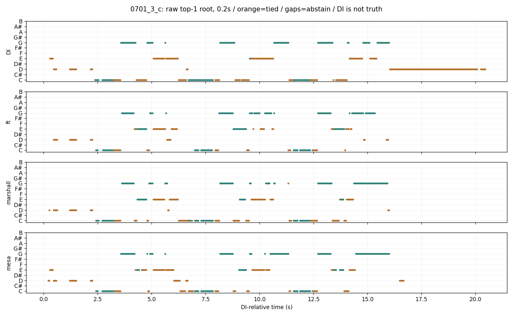

# EGDB 음색별 기존 오디오 분석기 비교 — 2026-11-05

**동일 예제 2종 × DI/Fender Twins/Marshall/Mesa 4종, 총 8개를 새로 추론했다.** 이번 표본에서는 DI 대비 앰프 음원에서 코드 보류가 늘고 음 후보가 달라졌다. 반면 Mesa가 항상 가장 크게 달라지지는 않았다. 이를 클린/오버드라이브/디스토션 강도별 성능 순위로 해석할 수 없다.

## 비교 조건

입력은 로컬 EGDB 데모 Training 8개 원본 WAV다. 원본 음량을 임의 정규화하거나 추가 주파수 컷을 하지 않았다. 기존 Basic Pitch ONNX raw 경로, MIDI 38~88 음 후보, 활성 임계 .3, max 0.2/0.4초, 기존 코드 채점·표시 정리를 사용했다. 튜닝이나 정답 코드로 모델 출력을 수정하지 않았다. 이 자료에는 대응 MIDI/코드 정답이 없으므로 **정확도를 산출하지 않았다. DI도 틀릴 수 있다.**

DI와 앰프 파일 길이가 달라 길이 비율로 늘리거나 줄이지 않았다. 오디오의 100Hz 양의 log-RMS 변화 상관으로 ±1초에서 시간차를 찾았고, 세 구간의 시간차도 점검했다. 모든 전체 시간차는 0초가 최댓값이었다. 6쌍 중 5쌍은 사전 설정한 임시 기준(상관 .35 이상, 구간별 시간차 범위 .04초 이하)을 통과했다. 0701 Marshall은 마지막 구간에서 -0.08초로 달라 **정렬 불확실**로 남겼다. 이 기준은 독립 측정된 정렬 신뢰도가 아니다.

## 코드 출력 변화 — 0.2초 창

보류는 기존 분석기가 충분한 피치클래스 근거를 얻지 못했다는 뜻이며, 반드시 실패나 오답은 아니다. 실제 단음·두 음 연주는 코드 이름을 낼 수 없는 경우도 있다. 두 쪽 모두 코드 후보가 있는 시점에서만 원시 1위의 일치를 계산했다. 행마다 분모를 함께 표기했다.

|예제|앰프 음색|DI 보류|앰프 보류|DI와 원시 1위 일치 · 양쪽 후보 있을 때|
|---|---|---:|---:|---:|
|0503_1_a|ft|187/609 (30.7%)|259/609 (42.5%)|84.1% (292/347)|
|0503_1_a|marshall|187/609 (30.7%)|230/609 (37.8%)|82.7% (310/375)|
|0503_1_a|mesa|187/609 (30.7%)|212/609 (34.8%)|85.5% (329/385)|
|0701_3_c|ft|47/489 (9.6%)|211/489 (43.1%)|58.4% (160/274)|
|0701_3_c|marshall ※|47/489 (9.6%)|173/489 (35.4%)|74.0% (230/311)|
|0701_3_c|mesa|47/489 (9.6%)|161/489 (32.9%)|72.8% (235/323)|

※ 0701 Marshall 행은 정렬 불확실 상태의 참고값이다. 나머지도 보정된 정답 시간축은 아니다. 비율은 DI 출력과의 일치이며 정답률이 아니다. 0.4초 결과와 원시 후보·동점·표시 정리 결과는 summary.json/records에 별도로 보관했다.

0503에서 음 후보 개수 중앙값은 DI 5개에서 앰프별 4개로 바뀌었다. 0701은 DI 5개, Fender Twins 3개, Marshall 4개, Mesa 5개였다. DI가 내던 음의 부재와 새 음 출현을 따로 집계했으며, **음표 정답이 없으므로 누락음/오검출로 확정하지 않는다.**

## 원음 증거와 코드 후보









위 스펙트럼은 같은 dBFS 축이며, 근음 그림은 청록=단독 1위, 주황=1위 동점, 빈 구간=보류다. 근음만 그린 그림으로 전체 코드 품질이나 정답 여부를 알 수 없다. 실제 파형/스펙트럼에서 산출한 자료이며 생성 이미지가 아니다.

모노 RMS는 0503 DI 약 -28.4dBFS/앰프 약 -26.4~-26.5dBFS, 0701 DI 약 -30.1dBFS/앰프 약 -26.5~-27.0dBFS였다. 앰프 음원이 단순히 더 작아서 생긴 현상으로 설명되지는 않는다. 다만 음량·EQ·압축·스테레오와 앰프 처리 효과를 분리한 통제 실험은 아니다.

## 직접 듣기

[8개 발췌 재생과 그림을 모은 검수 페이지](../dataset/integration_review/runs/egdb_timbre_20261105_v1/review.html). 0503은 DI 기준 2~7초의 고정 구간, 0701은 결과 차이가 컸던 15~20초를 사후 선택했다. 후자는 독립 평가 표본이 아니다. 정렬값에 맞춰 같은 구간을 발췌했고, 원본 입력은 그대로 보존했다. 청취용 MP3는 모노 변환했으며 음량 정규화는 하지 않았다.

DI만 코드 후보가 나오던 0701 약 18.04초에서 DI 음 후보는 MIDI 40/45/50/55/62, Fender Twins는 38/45/50이었다. DI는 Dsus2/Asus4 동점, Fender Twins는 보류였다. 이 차이가 DI의 추가음 오검출인지 앰프에서의 음 누락인지는 현재 자료로 확정할 수 없다.


## 검증과 판단

8개 추론의 원본 SHA-256을 전부 대조했고, 모델 출처와 실제 출력 NPZ/음표 이벤트/시간축을 보존했다. 합성 시간차·무음 정렬 보류·동일 음 후보의 자기 일치 검사 3개가 통과했다. 비교 단계에서 입력 후보나 채점 규칙을 바꾸지 않았다.

```powershell
python compare_egdb_timbres.py
python report_egdb_timbres.py
python -m unittest test_egdb_timbres -q
```

완료된 summary.json은 재실행으로 덮어쓰지 않는다. 새 추론은 별도 버전 출력 경로를 사용한다.

**현재 분석기를 일렉에 그대로 적용할 수는 있지만, 통기타에서 보던 결과가 유지된다고 가정하면 안 된다.** 다음 단계는 EGDB 본 데이터의 대응 음표 정답과 실제 앰프/게인 메타데이터를 확보해 음 검출과 코드 추정을 분리 평가하는 것이다. 이번 2예제만 보고 임계값을 낮추거나 앰프별 가중치를 맞추거나 새 모델을 학습하지 않는다.
