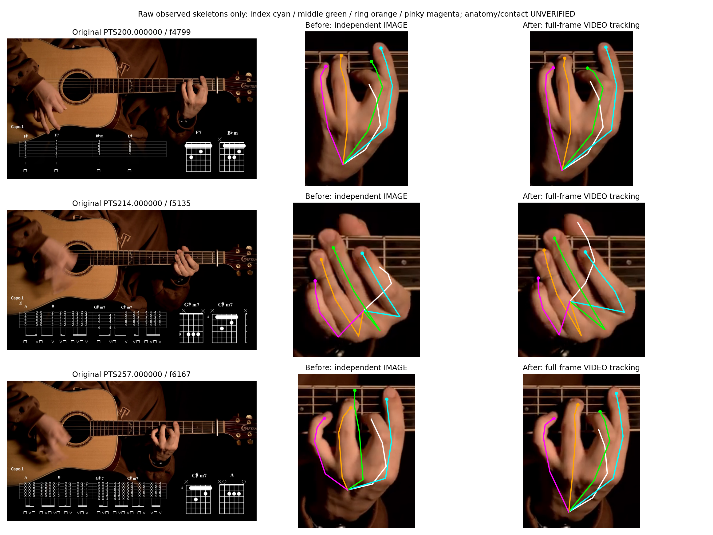
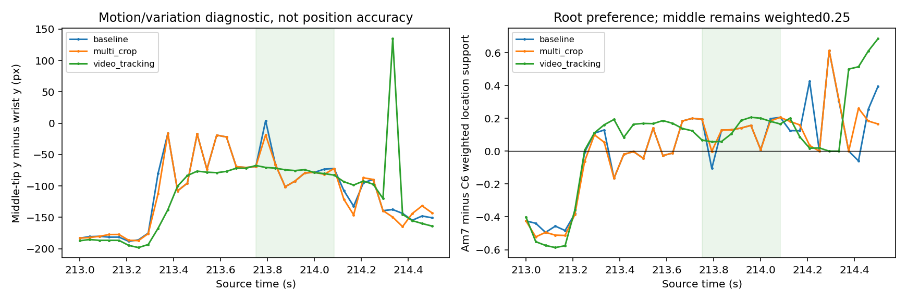

# 6·5번 현 주변 손 위치 안정화 — 2026-11-05

**새 모델을 학습하지 않고, 기존 MediaPipe의 VIDEO 추적 경로를 비교해 개선을 확인했다.** 현재화면만독립처리하는방식보다중지의프레임간튐이줄고214초근음가점도일관됐다. 손끝을수동으로이동하거나손가락이름을바꾸지않았다.

## 비교한 세 경로

1. 기존전역손선택+원본우선독립IMAGE검출.
2. 같은프레임에서찾은전체손범위로3종padding×2종확대크기(480/720)를만든후, 실제21점전체스켈레톤중하나를합의/제한적시간일관성으로선택. 손이많이이동하면이전위치가점을끈다.
3. **원본전체화면VIDEO모드**,2손탐색후현재지판근접성과방향으로운지손선택. 좌표의외부평균/보간을하지않고VIDEO모델의실제출력을사용한다.

200초전후1초,214초전후1.5초,257초전후1초를실행해총87프레임을비교했다. 모든경로가87/87곳에서손후보를반환했다. 확대실험과VIDEO추적의선택에오디오·화면코드·사용자정답을넣지않았다. 전체손을하나의검출결과로선택하며손가락별점을섞지않았다. 회전은기존원본우선fallback정책을유지했고추가확대뷰는0도만사용했다.

## 원본과 실제 스켈레톤 대조



왼쪽은 원본, 가운데는 기존 독립 검출, 오른쪽은 VIDEO 추적이다. 검지는 청록, 중지는 초록, 약지는 주황, 새끼는 자홍이다. 200초와 257초에서는 중지 끝이 손가락 밖으로 튀는 모습이 줄었다. 다만 214초의 손목과 손가락 뿌리를 잇는 연결은 여전히 어색해 보인다. 끝점의 안정성과 전체 관절의 해부학적 정확성은 별개이며, 사람 정답 좌표로 전수 검증하지 않았다.

## 시간 안정성

중지끝의손목상대위치가프레임사이얼마나바뀌는지90백분위수로비교했다. 실제움직임도포함하므로 **이값은좌표오차나오차율이아니다.** 단순히안정적인오검출일가능성도있어원본사진과함께해석한다.

|구간|기존 IMAGE|확대 합의|VIDEO 추적|
|---|---:|---:|---:|
|middle_200|28.27px|8.04px|5.56px|
|root_214|78.09px|68.57px|34.65px|
|new_257|61.79px|60.88px|8.76px|



214초에서기존중지끝은(888.37,227.06),VIDEO는(883.87,215.10)으로검출됐다. 모두각모델의실제추론좌표이며근음칸에맞추려고좌표를보정한것이아니다. 확대합의는214초에서기존검출과같은관측을선택해이장면의문제를크게해결하지못했다.

## 근음 가점 일관성

이전에원본을확인한213.75~214.083초9프레임에서기존저음현가중치를그대로적용했다. 중지는이전과같이0.25로낮게반영했다. 같은PC의C6/Am7(화면B6/G#m7)쌍은근음가점진단에만썼고스켈레톤선택에는사용하지않았다.

- 기존 IMAGE: G#m7쪽가점이높은8/9프레임,6·5번현A근음지지가0.05이상인7/9프레임.
- 확대 합의: G#m7쪽가점이높은8/9프레임,저음현지지7/9프레임.
- VIDEO 추적: **G#m7쪽가점이높은9/9프레임,저음현지지9/9프레임.**

214초단일프레임의VIDEO가점은Am7약0.206,C6약0.005로기존보다분명해졌다. 그러나가점은확률이나실제누름확정이아니다. 정확한가상현경계·해부학적의미·접촉검증은아직미완료이므로근음자동재정렬의기존검증차단규칙은풀지않았다. 214.2초이후의손이동을이전코드의근거로빌려쓰지도않았다.

## 실제 영상

[원본213~214.5초: 기존/VIDEO 손 추적 비교](../dataset/hand_analysis/runs/low_string_stability_20261105_v1/root_213_214_5_before_after.mp4)

위쪽원본은그대로이고아래왼쪽은기존,아래오른쪽은VIDEO추적이다.24fps원속도이며기타추정음을같은원본시각에서맞췄다. 짧은영상은일시정지해원본사진과함께확인하는것이좋다. 리사이즈된확대보기는시각검수용이지좌표평가원본이아니다.

## 적용·검증

`whole_hand_consensus.py`에원본21점보존선택을추가했고`review_low_string_hand_stability.py`에현재원본화면VIDEO추적비교경로를추가했다. 기존모델·음원·기존오디오코드경로는변경하지않았다. 평가범위밖의전체영상자동추적성공을주장하지않는다.

178개테스트통과. 현재프레임의실제관측중선택, 손미검출시이전좌표복사금지, 손이동시시간가점해제와기존손/오디오/화성회귀를확인했다. 모든선택에원본모델출처·영상프레임·PTS·확대변환을보관했다.

```powershell
python review_low_string_hand_stability.py
python report_low_string_hand_stability.py
python -m unittest test_whole_hand_consensus test_low_string_root_prior test_visual_root_tiebreak test_chord_display_cleanup test_chord_display_stabilizer test_audio_change_pool test_temporal_audio_pool test_oracle_chord_audit test_audio_note_calibrator test_basic_pitch_clock test_basic_pitch_adapter test_cut_audio_features test_harmonic_chord_features test_harmonic_chord_benchmark test_idmt_chords_benchmark test_chord_score_variants test_guitarset_benchmark test_bandcut_weight_sweep test_audio_analysis test_guitar_stem_comparison test_tutorial_reference_evaluation test_new_hand_harmony test_harmony_engine test_cell_audio_fusion test_hand_cell_distribution test_virtual_string_grid test_global_fretting_hand -q
```

완료원본결과는덮어쓰지않는다. 모든원본사진·실제관측·경로별결과는result.json/frames, 수치집계는summary.json에있다. 다음확인대상은VIDEO중지/검지의의미가원본손가락과맞는지와6·5번가상현경계다. 안정성개선과해부학적정확성완료를동일시하지않는다.
