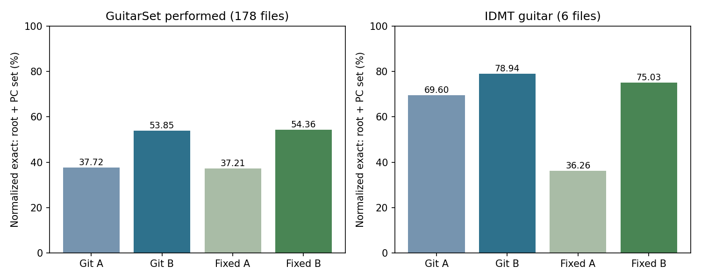
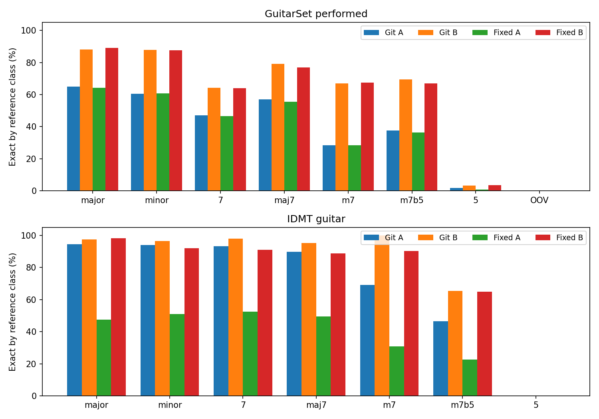
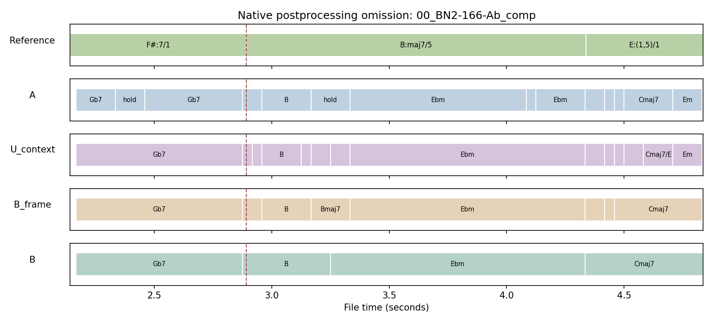
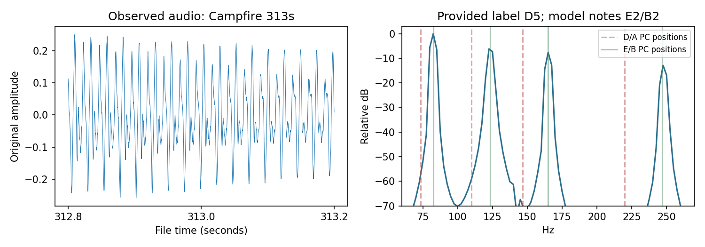

# Guitar Chord Studio 현재 시스템 성능 재평가 — 2026-11-12

실행 시작: 2026-11-11(KST). 전수 실행 및 보고: 2026-11-12. 모델·가중치·알고리즘·문턱값의 변경, 학습 및 데이터별 파라미터 탐색은 하지 않았다. 주 결과는 **GitHub에 커밋된 상태**, 수정 분리 경로는 별도 보충 실험이다.

## ① 현재 시스템 구성

- 평가 GitHub 커밋: `5c5396bc2c3ac8a667cd0fb42db66e09340742cd`. 로컬 기준 HEAD: `eb15c93712dacd47e48624d2a142f96014f9597d`. GitHub 최신 변경은 README뿐이며, 핵심 알고리즘은 두 트리에서 줄바꿈/BOM을 정규화하면 같다. 로컬 분리 수정은 미커밋 상태이므로 커밋의 기능으로 포장하지 않는다.
- 실제 호출: Git 스냅샷 또는 로컬의 `chord_studio_v2/server_v2.py:analyze(job_id, demo=False, separate_guitar=True)` → FFmpeg 22050Hz mono PCM16 추출 → 분리 시도 → `basic_pitch_worker.run_basic_pitch_tasks` → `chord_web_analysis.write_result`/`make_timeline`. 각 녹음 전체를 분석했으며 정답 코드·평가 시각은 추론 함수에 넣지 않았다.
- **GitHub 원본**: 분리 스크립트가 프로젝트 루트를 `engine`으로 잘못 잡아 격리 환경 탐색에서 실패한다. 실제 로그와 모든 파일별 `separation_status`에 fallback이 기록된다. Demucs 추론은 실행되지 않았고, 원음의 Basic Pitch 추론은 실제 실행됐다.
- **로컬 수정 경로**: 분리 워커가 로컬 safetensors를 로드해 CPU Demucs 6-source 추론을 실제 실행한다. 생성된 guitar.wav와 원음에 Basic Pitch를 각각 적용하고, 기타 후보에 전체 믹스 앵커를 더한다. 이 측정은 배포 EXE와 같은 핵심 코드의 **소스 실행 경로**이며 GUI/EXE 시작 성능 재평가와는 구분한다.
- 모델: Basic Pitch **0.4.0**, ONNX Runtime **1.23.2**, `CPUExecutionProvider`, 4스레드. ONNX SHA-256 `2c3c1d144bfa61ad236e92e169c13535c880469a12a047d4e73451f2c059a0ec`. Demucs **4.1.0**, CPU PyTorch **2.14.1+cpu**, 4스레드, `htdemucs_6s`, shifts=0, 7초 분할, overlap=.25. safetensors SHA-256 `d2a1745f0744721f6b8ca5bf469b67c651ea5ed1b52998cab033b2158609d411`.
- Basic Pitch 사용 방식: 약 2초 입력창, 30프레임 중첩, 양쪽 15프레임 제거 및 입력 샘플 기반 시간축. note/onset/contour 및 MIDI를 실제 생성한다. 코드 분석은 MIDI 이벤트가 아니라 저장한 note activation을 쓴다. 입력 파형 FFT 컷은 하지 않는다. 공식 디코더 frame=.3/onset=.5/minimum11frames를 통과한 뒤 NPZ를 저장하며, 디코더의 음역 제한이 배열을 변경한다. 명목상 D2~E6 제한이지만 v0.4.0 max-frequency 슬라이스는 E6 경계를 제외한다. 이를 평가 중 고치지 않았다.
- 후보·채점: 0.2초 기본 / 0.4초 보조 최대값 pooling → activation .3 이상 음을 12-PC로 합산·정규화 → 활성 PC≥3 → 15종×12근음=180 템플릿. 점수는 `구성음 salience 합 / 전체 salience 합 − .15 × 누락 구성음 비율`이며 확률이 아니다. 사전 동점 순서를 그대로 유지한다.
- 후처리: 기존 짧은 A-B-A/드롭아웃 정리, 0.8초 아르페지오 회복, 지속 저음/전역 조성/앞뒤 진행의 가점, 원음 앵커, 온셋과 새로운 PC가 함께 있을 때의 가점, Look-Ahead confirm=.25초·같은 근음 확장음 통합, 보수적인 분수코드 표기, 자동 BPM/마디 정렬 및 16분음표 격자(4/4 한 마디 16칸). 두 음이 완전5도이면 현재 규칙은 파워코드가 아니라 장/단화음을 가정하는 회복 분기도 갖는다.
- A는 native `row.top3[0]`; B는 native `row.onset_presentation.display_candidates`. 모델과 특징 pooling은 동일하지만 **A/B는 전체 후처리 스택의 비교**다. Look-Ahead 단독 효과라고 주장하지 않는다. `U_context`와 `B_frame`은 각각 prepare 전/격자 전의 기존 기록을 그대로 읽는 진단층이다. UI 기본 표시 선택도 실제 app.js 실행으로 표본 대조했다. 수동 BPM·카포·코드 편집·비전은 적용하지 않았다.
- 과거 별도 음높이 보정 신경망(`audio_note_calibrator`)은 현재 실행 경로에 import/가중치 로드가 없으며 평가에 추가하지 않았다. 사용한 음높이 모델은 위 사전학습 Basic Pitch다.
- 환경: AMD Ryzen 5 5600X 6-Core Processor, 물리6코어/논리12스레드, RAM 약16GB, Windows, Python 3.10.11. RTX3060이 있으나 **GPU는 사용하지 않았다**. 한 번에 한 녹음만 실행했다. 버전 잠금·환경·모델 출처·소스 원본/패치는 실행 폴더에 보존했다.

A는 원시 중간 기록을 읽는 출력 ablation이다. 프로그램에 후처리를 완전히 건너뛰는 실행 스위치가 없어 B 계산을 실제 생략한 별도 A 전체 실행은 하지 않았다. UI의 context 끄기도 기존 cleanup이 남으므로 완전한 안정화 OFF로 취급하지 않았다.

## ② 평가 데이터

| 데이터 | 실제 분석 | 주 평가 | 평가 시각/정답 |
|---|---:|---:|---|
| GuitarSet | comp 180파일 | 178파일, 정답층별 4,886시점 | 과거 고정 1초 격자(.5초 시작); nominal/performed 별도 |
| IDMT-SMT-Chords | 기타 6음색 | 1,638구간 | 과거 273구간×6음색의 각 구간 중심 |

원본 길이는 GuitarSet 5484.22초, IDMT 기타 3276.00초다. 주석·오디오 SHA-256 및 평가 격자를 과거 실험과 대조했고, 분모는 전 파일에서 정확히 재현됐다. 코드 안정 구간 양끝에서 기존 `.05 + 4096/44100` ≈143ms를 제외한다. IDMT는 음색마다 같은 진행을 반복하므로 1,638개를 독립적인 곡으로 해석하지 않는다.

GuitarSet의 알려진 시간 오류 `04_BN3-154-E_comp`, `04_Jazz1-200-B_comp`는 실제 분석하되 주 집계에서 제외했다. 주석 이동은 하지 않았다. solo180파일은 기존 comp 평가와 맞추기 위해 제외했고, IDMT non_guitar10파일도 기존 Basic Pitch 기타 비교 범위와 맞추기 위해 제외했다. N/X, 미지원 문법, 경계/무주석은 제외·집계하며, 파싱 가능한 사전 밖(OOV) 코드는 오답으로 분모에 남겼다. 주석상 코드가 있는 시점에서 모델이 무음/근거 부족으로 보류해도 제거하지 않고 오답 처리한다.

이번 집합은 과거 FFT/초기 Basic Pitch 진단과 동일한 평가 파일·시각이며 새 train/test 분할은 만들지 않았다. 과거 별도 보정 신경망의 학습 분할을 재사용했다고 주장하지 않는다. 이미 열람한 6연주자 전체 comp 집합이므로 연주자 홀드아웃이나 독립 테스트라는 표현도 쓰지 않는다.

정규화 Exact는 과거와 같은 **근음+PC집합** 일치다. 이명동음·옥타브·확장도수는 PC로 정규화하고 베이스 음은 집합에 합치지만 전위 표기는 별도로 요구하지 않는다. 따라서 완전한 보이싱·분수코드 정확도가 아니다. 근음 정확도와 코드 종류(근음 기준 상대 PC집합) 정확도는 각각 독립적으로 계산한다. B의 복수 후보는 정답 후보가 포함돼도 strict top1 오답이다. 베이스 표기까지 요구한 추가 결과를 아래에 별도 제시한다.

발견한 주석 불확실성: IDMT Campfire 313초의 제공 주석은 D:5지만 실제 피크는 약82.5/122.5Hz(E/B 부근), 모델 출력도 MIDI40/47이었다. 주석을 변경하거나 이 사례를 분모에서 제거하지 않았다. 제공 주석 기준 결과와 주석 품질 의심을 구분한다. MIDI 원본/전문가 검증 없이 정답을 새로 확정하지 않았다.

## ③ 정량 평가 결과

### GitHub 커밋 그대로 — 분리 실패 후 원음 경로

| 데이터/정답층 | 구성 | 정규화 Exact | 근음 | 코드 종류 | 분모 | 처리 시간 |
|---|---|---:|---:|---:|---:|---|
| GuitarSet 상세 연주 | A | 37.72% | 51.84% | 38.13% | 4,886 | 원시 후처리 8.35s (두 창 합계); 단독 E2E 미측정 |
| GuitarSet 상세 연주 | B | 53.85% | 79.19% | 54.75% | 4,886 | 408.52s / 오디오 5444.89s; RTF 0.075 |
| IDMT 기타 | A | 69.60% | 72.77% | 73.14% | 1,638 | 원시 후처리 6.51s (두 창 합계); 단독 E2E 미측정 |
| IDMT 기타 | B | 78.94% | 85.16% | 83.39% | 1,638 | 243.15s / 오디오 3276.00s; RTF 0.074 |

GuitarSet 기본 악보 정답층은 A 35.51%, B 52.44%다. 기본/상세 중 높은 쪽만 골라 제시하지 않는다.

### 보충: 로컬 분리 수정 경로 — 실제 Demucs + 전체 믹스 앵커

| 데이터/정답층 | 구성 | 정규화 Exact | 근음 | 코드 종류 | 분모 | 처리 시간 |
|---|---|---:|---:|---:|---:|---|
| GuitarSet 상세 연주 | A | 37.21% | 50.96% | 37.62% | 4,886 | 원시 후처리 8.81s (두 창 합계); 단독 E2E 미측정 |
| GuitarSet 상세 연주 | B | 54.36% | 79.37% | 55.40% | 4,886 | 3597.37s / 오디오 5444.89s; RTF 0.661 |
| IDMT 기타 | A | 36.26% | 39.01% | 37.67% | 1,638 | 원시 후처리 4.56s (두 창 합계); 단독 E2E 미측정 |
| IDMT 기타 | B | 75.03% | 83.27% | 79.37% | 1,638 | 1827.40s / 오디오 3276.00s; RTF 0.558 |

GuitarSet 기본 악보 정답층은 A 35.14%, B 52.70%다. 기본/상세 중 높은 쪽만 골라 제시하지 않는다.

처리 시간은 실제 analyze() 벽시계 합계이며 업로드 복사·평가 CSV/통계 작성 시간은 제외한다. 분리·모델·기본 후처리·result.json 저장은 포함한다. A는 B와 전처리/추론을 공유했으므로 독립적인 A 전체 처리 시간을 측정했다고 주장하지 않는다. A의 pooling/scorer 두 분기만 추가로 실제 계측했다. RTF는 각 데이터 안의 관측값이며 CPU 부하/초기화 영향이 있고 속도를 보장하지 않는다.

### 코드 종류별 정규화 Exact

| 데이터 | 정답 종류 | N | Git A | Git B | 수정 A | 수정 B |
|---|---|---:|---:|---:|---:|---:|
| GuitarSet 상세 | major | 1693 | 64.97% | 88.19% | 64.15% | 89.19% |
| GuitarSet 상세 | minor | 516 | 60.47% | 87.79% | 60.66% | 87.60% |
| GuitarSet 상세 | 7 | 294 | 46.94% | 64.29% | 46.60% | 63.95% |
| GuitarSet 상세 | maj7 | 272 | 56.99% | 79.04% | 55.51% | 76.84% |
| GuitarSet 상세 | m7 | 221 | 28.51% | 66.97% | 28.51% | 67.42% |
| GuitarSet 상세 | m7b5 | 88 | 37.50% | 69.32% | 36.36% | 67.05% |
| GuitarSet 상세 | 5 | 407 | 1.72% | 3.19% | 0.74% | 3.44% |
| GuitarSet 상세 | OOV | 1190 | 0.00% | 0.00% | 0.00% | 0.00% |
| IDMT 기타 | major | 234 | 94.44% | 97.44% | 47.44% | 98.29% |
| IDMT 기타 | minor | 234 | 94.02% | 96.58% | 50.85% | 91.88% |
| IDMT 기타 | 7 | 234 | 93.16% | 97.86% | 52.56% | 91.03% |
| IDMT 기타 | maj7 | 234 | 89.74% | 95.30% | 49.57% | 88.89% |
| IDMT 기타 | m7 | 234 | 69.23% | 100.00% | 30.77% | 90.17% |
| IDMT 기타 | m7b5 | 234 | 46.58% | 65.38% | 22.65% | 64.96% |
| IDMT 기타 | 5 | 234 | 0.00% | 0.00% | 0.00% | 0.00% |

모든 코드 종류의 근음·종류 일치 수도 `per_quality.csv`에 저장했다. OOV는 표현 불가능해도 분모에 남겼다.

### 같은 선행 문맥을 유지한 단계별 진단

| 경로/데이터 | prepare 전 U_context | Look-Ahead 표시 후·격자 전 | 최종 B |
|---|---:|---:|---:|
| github/guitarset_performed_0.2 | 46.19% | 49.92% | 53.85% |
| github/idmt_nominal_0.2 | 74.48% | 77.29% | 78.94% |
| patched/guitarset_performed_0.2 | 45.85% | 49.82% | 54.36% |
| patched/idmt_nominal_0.2 | 70.27% | 72.53% | 75.03% |

U_context에도 앞뒤 진행·기존 cleanup 등 시간 정보가 이미 들어 있다. 이 표는 선행 문맥을 고정한 뒤 prepare와 격자 단계에서 무엇이 바뀌는지 보는 것이며, 완전한 무시간 모델과 Look-Ahead만의 순수 비교는 아니다. 기본 0.2초 이외의 기존 0.4초 분기도 동일하게 실행·보존했으며 좋은 쪽을 고르지 않았다.

### 전위 베이스 표기까지 포함한 추가 Exact

| 데이터/정답층 | Git A | Git B | 수정 A | 수정 B |
|---|---:|---:|---:|---:|
| GuitarSet 상세 | 30.17% | 43.90% | 29.68% | 43.72% |
| IDMT 기타 | 69.60% | 77.17% | 36.26% | 73.44% |

주석의 `/도수`를 bass PC로 해석하고, 분모 없는 예측은 근음 위치 표기로 읽었다. 이 표는 예측 코드의 표기 일치이며 물리적으로 어떤 현이 최저음인지 확인한 지표는 아니다. 과거의 전위 제외 Exact와 섞어 비교하지 않는다.

### 짧은 변동 및 정답 전환

| 경로/데이터 | A 0.2초 미만 코드 구간 | B 0.2초 미만 | A 정답 양측 재현 | B 정답 양측 재현 | 분모 |
|---|---:|---:|---:|---:|---:|
| github/GuitarSet 상세 | 5883 | 70 | 496 | 669 | 1960 |
| github/IDMT 기타 | 1915 | 19 | 993 | 1239 | 1626 |
| patched/GuitarSet 상세 | 5753 | 47 | 488 | 671 | 1960 |
| patched/IDMT 기타 | 1612 | 11 | 498 | 1071 | 1626 |

짧은 변동은 native24Hz의 비어 있지 않은 코드 run<.2초다. 전환 재현은 주석 경계 ±.5초 내 양측의 정확한 코드가 모두 등장하는지 확인한 별도 진단이며, 표준 전환 검출 F1이 아니다. OOV도 포함하는 전체 정답 전환의 재현 수다. 1초 샘플 Exact와 분모를 공유하지 않는다. 짧은 변동 감소를 정확도 향상과 동일시하지 않는다.

## ④ 과거 실험과 비교

| 결과 출처/방법 | GuitarSet 기본 | GuitarSet 상세 | IDMT 기타 |
|---|---:|---:|---:|
| 2026-11-05 FFT 피크/coverage | 11.60% | 13.34% | 44.38% |
| 2026-11-05 FFT 피크/cosine | 16.21% | 19.83% | 36.08% |
| 2026-11-05 harmonic/coverage | 9.62% | 12.61% | 56.11% |
| 2026-11-05 harmonic/cosine | 17.74% | 21.63% | 50.24% |
| 2026-11-05 초기 BP raw/instant frame | 26.44% | 26.87% | 65.14% |
| 이번 실행 github A | 35.51% | 37.72% | 69.60% |
| 이번 실행 github B | 52.44% | 53.85% | 78.94% |
| 이번 실행 patched A | 35.14% | 37.21% | 36.26% |
| 이번 실행 patched B | 52.70% | 54.36% | 75.03% |

과거 행은 **기존 저장 예측을 동일 기준으로 다시 집계한 값**이며 신규 추론이 아니다. 동일 파일 SHA·주석·평가시각·정답 변환·분모를 확인했으므로 같은 데이터 내 시스템 출력은 비교할 수 있다. 다만 FFT의 약186ms 창, BP 약2초 문맥, 현재 최대값 pooling/FFmpeg 재표본화/후처리/분리·앵커 차이가 있어 순수 Basic Pitch 도입 효과나 Look-Ahead 단독 효과로 해석할 수 없다. 예전 100ms 표본 48,326시점 수치와 이 표의 1초 4,886시점 수치를 직접 이어 붙이지 않는다. 두 데이터셋의 절대 정확도를 비교해 일반화 성능을 판단하지 않는다.

## ⑤ 실패 사례

| 경로/데이터 | 가장 빈번한 B 오판 | 발생 시점 수 |
|---|---|---:|
| github/GuitarSet 상세 | C#:(1,5)/1 -> Db | 39 |
| github/GuitarSet 상세 | G#:(1,5)/1 -> Ab | 30 |
| github/GuitarSet 상세 | E:(1,5)/1 -> E | 23 |
| github/GuitarSet 상세 | D#:(1,5)/1 -> Eb | 21 |
| github/GuitarSet 상세 | C:maj6/5 -> Am7 | 19 |
| github/IDMT 기타 | D:(1,5) -> E | 23 |
| github/IDMT 기타 | D#:(1,5) -> F | 12 |
| github/IDMT 기타 | F#:(1,5) -> Ab | 12 |
| github/IDMT 기타 | A:(1,5) -> B | 12 |
| github/IDMT 기타 | A#:(1,5) -> C | 12 |
| patched/GuitarSet 상세 | C#:(1,5)/1 -> Db | 32 |
| patched/GuitarSet 상세 | G#:(1,5)/1 -> Ab | 25 |
| patched/GuitarSet 상세 | E:(1,5)/1 -> E | 23 |
| patched/GuitarSet 상세 | D#:(1,5)/1 -> Eb | 20 |
| patched/GuitarSet 상세 | C:7(*5)/1 -> C7 | 17 |
| patched/IDMT 기타 | D:(1,5) -> E | 14 |
| patched/IDMT 기타 | E:(1,5) -> Gb | 11 |
| patched/IDMT 기타 | C:(1,5) -> D | 11 |
| patched/IDMT 기타 | D:(1,5) -> <abstain> | 10 |
| patched/IDMT 기타 | A:(1,5) -> B | 10 |

실제로 A가 맞았는데 B가 틀린 시점 수:

- github/guitarset_performed: A만 정답 80, B만 정답 868, 둘 다 오답 2175.
- github/idmt_nominal: A만 정답 10, B만 정답 163, 둘 다 오답 335.
- patched/guitarset_performed: A만 정답 73, B만 정답 911, 둘 다 오답 2157.
- patched/idmt_nominal: A만 정답 6, B만 정답 641, 둘 다 오답 403.

확인된 사실: raw scorer는 PC≥3을 요구해 실제 2음 파워코드에서 보류할 수 있다. 현재 두 음 회복 규칙은 근음+완전5도에 장/단화음을 가정한다. 실제 IDMT Campfire313초 기록은 raw=[], context E(score=.85), final E였으며 정답은 D:5였다. 이는 파워코드 처리와 해당 주석의 음향 불일치 의심을 모두 포함하므로 어느 하나만 원인이라고 단정하지 않는다.

후처리로 새 코드가 주석 구간 전체에서 사라진 사례는 단순 .5초 지연과 구분했다. 아래는 양측 .5초 이상이며 사전으로 표현 가능한 정답 전환만의 단계별 진단이다. 두 손실 수는 서로 다른 단계 비교이며 합쳐 최종 누락 수라고 부를 수 없다.

| 경로/데이터 | 해당 정답 전환 | context→격자 전 새 코드 소실 | 격자 전→최종 소실 |
|---|---:|---:|---:|
| github/guitarset_performed | 1126 | 20 | 55 |
| github/idmt_nominal | 1626 | 11 | 45 |
| patched/guitarset_performed | 1126 | 19 | 49 |
| patched/idmt_nominal | 1626 | 8 | 75 |

모든 개별 시각·정답·예측은 CSV와 transition_diagnosis.json에 남겼다. 입력/모델/점수/최종 표시를 구분하며, 원인 후보(분리 중 음 근거 약화, 조성·이웃 우선, 격자 병합)는 인과적으로 분리한 실험이 아니므로 추정으로만 다룬다. 제공 주석 기준의 오답이 항상 실제 음악적으로 잘못된 해석이라는 뜻도 아니다.

그림은 사전순 첫 상세 주석 소실 사례를 선택한 진단용 예시다. 위에서부터 제공 정답, 원시 A, prepare 전 문맥, 격자 전, 최종 B다. Bmaj7 후보가 잠깐 등장했지만 최종 격자 단계에서 사라졌다. 이 한 예시를 전체 정확도나 모든 소실의 원인으로 일반화하지 않는다.

빨간 점선은 제공 D5의 D/A 음고류 주파수 위치, 초록은 관측/모델의 E/B 부근 위치다. 피크만으로 새 정답을 확정하지 않았다. 해당 원본 2초 음원은 로컬 실험 폴더에만 보존한다.

최종 분석 종료 상태가 error인 파일: 0건. GitHub 원본의 분리 단계 실패/fallback은 별도의 186건이며 정상 Demucs 실행으로 세지 않는다. 초기 평가 어댑터의 SHORTHANDS 누락은 실패 기록을 보존하고 원본 상수를 그대로 복원한 뒤 새 출력으로 재실행했다. 집계 열 이름 충돌 등 평가 도구 오류도 evaluator_incidents.json에 남겼다. 예측 알고리즘이나 문턱값은 고치지 않았다. GitHub의 분리 실패/fallback은 숨기지 않고 평가된 실제 실행 상태로 별도 집계했다.

## ⑥ 결론

- 현재 Basic Pitch 추론과 후처리의 실제 성적을 재현 가능한 실행물로 확보했다. 원시 후보·후처리 출력·상세 실패 기록이 분리돼 있어 어느 단계에서 오판이 생겼는지 추적할 수 있다.
- 단독 기타와 합성 기타에서의 관측값이며, 밴드/보컬이 있는 실제 영상·새 연주자·새 곡 전체에 대한 정확도로 확대하지 않는다. 파워코드/OOV/전위, 후처리의 실제 코드 소실은 남아 있는 한계다.
- GitHub의 Demucs fallback과 로컬 수정 경로를 구분해야 한다. 분리+전체 믹스 앵커의 결과 차이는 두 경로 전체의 비교이며 Demucs 단독 인과 효과가 아니다. 수치를 좋게 만들려고 어느 경로든 제거하거나 파라미터를 바꾸지 않았다.
- GuitarSet은 Basic Pitch 연구의 학습 자료에 포함되고 이 프로젝트에서도 이미 여러 번 열람한 자료다. 현재 평가는 독립적인 미열람 테스트가 아니다. 데이터셋 간 높은/낮은 절대 정확도로 일반화를 주장하지 않는다.
- 실험 C는 미실행: 두 데이터셋에 동기화된 영상/비전 정답이 없어 실제 비전 융합 성능을 검증할 수 없다. 가상 손/지판 후보는 넣지 않았다. 현 접촉·개방현·뮤트·타브·크롬 확장·전체 운지 시스템 정확도도 이번 수치로 확인할 수 없다.

## ⑦ 포트폴리오용 요약 (200~300자)

GitHub 커밋 5c5396b의 실제 오디오 경로를 동결해 GuitarSet 178파일·4,886시점과 IDMT 기타 6음색·1,638구간을 평가했다. 근음·음고류 집합 일치율은 원시/후처리 각각 GuitarSet 37.72%/53.85%, IDMT 69.60%/78.94%였다. 분리 실패 후 원음 대체와 후처리의 정답 소실도 기록했다. 전위·학습 자료 중복·주석 불확실성을 별도 명시했으며 비전이나 전체 운지 정확도를 뜻하지 않는다.

공백·기호 포함 245자.

## 재현 및 상세 기록

[재현 명령](current_20261111/README.md) · [고정 프로토콜](current_20261111/PROTOCOL.json) · [파일·시각별 정답과 예측 CSV.gz](published_20261112/all_predictions.csv.gz) · [집계 JSON](published_20261112/summary.json) · [종류별 CSV](published_20261112/per_quality.csv) · [오판 CSV](published_20261112/confusions.csv) · [파일별 시간](published_20261112/per_file.csv) · [전환 누락 상세](published_20261112/transition_diagnosis.json). 실행 폴더에 전체 생산 코드 스냅샷, Git 패치, 새 NPZ/MIDI/result.json 및 stderr 로그를 보존했다.

근거: [Basic Pitch 공식 구현](https://github.com/spotify/basic-pitch), [Basic Pitch 논문](https://arxiv.org/abs/2203.09893), [GuitarSet 공식 저장소·주석 오류 안내](https://github.com/marl/GuitarSet), [IDMT 공식 데이터 설명](https://www.idmt.fraunhofer.de/en/publications/datasets/chords.html). 과거 숫자의 근거는 archived source hash와 historical_comparison.json이며 신규 실험으로 표시하지 않았다.
